# liquid_glass_shader

iOS-style liquid glass for Flutter, drawn by Flutter itself, in one fragment shader and no native code, so iOS and Android look the same. Its looks are measured from iOS 27: the standard glass that scatters a busy page without fogging it, the clear glass for photos, and the Clear to Tinted slider between them. With Impeller, glass refracts what is behind it: the view bends hard toward the rim, which mirrors what lies deeper in, and catches a thin line of light along the top and the bottom. Without Impeller it falls back to a frosted blur, and under high contrast to an opaque surface.

It also ships `LiquidTabBar`, a tab bar that behaves like the iOS 26 one: press anywhere to lift a clear lens, drag it across the tabs, and let go to select. It hugs its tabs or fills its width, takes the sizes of iPhone, iPad and landscape bars, stands up as a column at the side of a screen, shrinks into a pill while a page scrolls, and works with a keyboard, a screen reader and right-to-left text.

<p>
  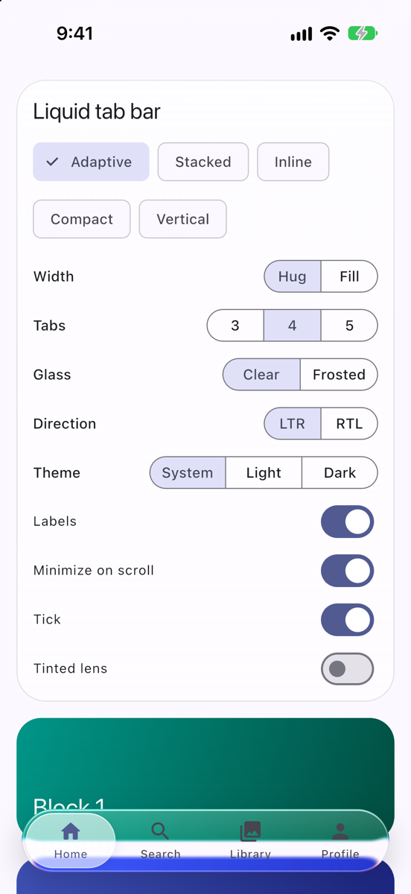
  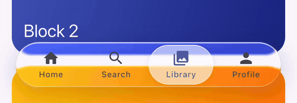
</p>

## How it works

`GlassBackdrop` pushes a backdrop filter layer whose filter is `shaders/liquid_glass.frag`. For each pixel inside the glass's rounded rectangle, the shader measures the distance to the edge and samples the backdrop displaced inward along the edge normal, by the profile measured on iOS 27: nothing in the middle, and at the very rim as far as the middle of the glass, so the rim shows what lies deep inside, mirrored. It can split red and blue at the rim (dispersion; iOS 27 has none, so the looks leave it off), magnify the whole interior, and it raises saturation so what shows through looks vivid. Pixels outside the glass return at once, so the cost stays with the glass's own area. Pixels in the flat middle, farther than the rim band from the edge, skip the bend and the highlight. Near the rim the edge direction comes from the rounded rectangle's gradient in closed form, not from extra distance evaluations.

The standard glass of iOS 27 does not blur the page: behind a tab bar about a third of it stays sharp, and the rest is scattered widely, so stripes behind the bar keep their edges and lose two thirds of their contrast. The shader does the same (`GlassLook.diffusion`) from thirty-two more backdrop reads spread like a Gaussian 14 logical pixels wide. Each pixel turns those reads by its own angle; with them in the same places for every pixel, an edge behind the glass showed as a row of ghost edges. Dark glass also dims bright content (`GlassLook.dim`), white the most and black not at all, so light labels stay readable over a white page.

A light frost, like the clear look's, is taken in the shader too: sixteen backdrop reads spread like a Gaussian, so no two line up in any direction. Neither it nor the diffusion needs the engine's blur in front of the shader, which, because the engine cannot tell where a shader filter reads, runs over the whole screen. A look of your own that asks for a heavy frost still gets the engine's blur, which downsamples.

The shader places the glass by where its box actually is on screen, so scaling, transforms and RTL all line up. When an ancestor moves the glass without repainting it (a page transition sliding a bar), the glass notices after the frame and repaints.

## Requirements

- Flutter 3.47 or newer.
- Refraction needs Impeller: iOS, and Android with Vulkan or OpenGL ES. Skia, web and widget tests get the blur tier; nothing to configure.

## Quick start

```dart
import 'package:liquid_glass_shader/liquid_glass_shader.dart';

// Any chrome that floats over content.
GlassSurface(
  borderRadius: BorderRadius.circular(28),
  padding: const EdgeInsets.all(16),
  child: const Text('On glass'),
)
```

A `GlassScope` is optional. Without one, glass is regular, the standard glass of iOS 27, and follows the app's brightness: the Material or Cupertino theme's, or else the platform's. Add one near the root to choose the style, theme or performance guard for everything below it:

```dart
GlassScope(
  style: GlassStyle.regular,      // or GlassStyle.clear, GlassStyle.frosted
  theme: GlassThemeData.light(),  // or your own colours
  child: MyHomePage(),
)
```

- `GlassStyle.clear` is for glass over photos and video: a light frost and a faint tint.
- `GlassStyle.regular` keeps the page in view, partly scattered and tinted.
- `GlassStyle.frosted` is milky: what is behind reads only as soft colour. It is the Tinted end of the iOS 27 slider.

iOS 27 lets its user slide Liquid Glass from Clear through Default to Tinted. `tinting` does the same for everything below a scope, in place of `style`: 0 is the clear look, 0.5 regular, 1 frosted, and anything between is a blend. The slider's own Clear end still tints a little; it sits near 0.3.

```dart
GlassScope(
  tinting: userSetting, // 0 to 1; save it and offer a Slider
  child: MyHomePage(),
)
```

A surface can insist on a style (`style: GlassStyle.frosted` for text sitting right on the glass) or take a custom `GlassLook`. `strength` from 0 to 1 fades all of the glass in, which suits a title bar that collapses as the page scrolls.

`GlassSurface` and `LiquidTabBar` put their content on a transparent `Material`, so ink from buttons and list tiles shows on the glass. That `Material` also sets the text style below it to the Material body style, so in a Cupertino or plain `WidgetsApp` give text inside the glass the style you want.

## The example

The example app is a playground: one colourful page under the bar, with a glass card of controls for the layout, hugging or filling, 3 to 5 tabs, labels, glass from clear to frosted, LTR or RTL (with Arabic labels), the theme, minimize on scroll, the tick and a tinted lens. Every picture here comes from it.

```bash
cd example && flutter run
```

## Liquid tab bar

```dart
Stack(
  children: [
    page, // scrolls under the bar
    Positioned(
      left: 21,
      right: 21,
      bottom: 21,
      child: LiquidTabBar(
        tabCount: 4,
        selectedIndex: tab,
        onSelected: (index) => setState(() => tab = index),
        tabBuilder: (context, index, active) => Column(
          mainAxisSize: MainAxisSize.min,
          children: [
            Icon(icons[index], color: active ? selectedColor : idleColor),
            Text(labels[index]),
          ],
        ),
      ),
    ),
  ],
)
```

It works as `Scaffold.bottomNavigationBar` too (with `extendBody: true` so the page scrolls under it).

- The bar calls `onSelected` on release, never while the finger is still down. A change of `selectedIndex` from elsewhere slides the lens there.
- Tabs are passive content. The bar handles touch, the keyboard and screen readers, so don't put an `InkWell`, `GestureDetector` or button semantics inside a tab: a tap would select twice. Each tab is a button for screen readers, with its selected state, labelled by the text your `tabBuilder` draws (or an icon's `semanticLabel`).
- A tab is laid out at its own size, centred in its slot, and scaled down when it does not fit, so a long label or large text is never cut short. Give it a size of its own: no `Expanded` inside.

### Sizes and presets

`LiquidTabBarMetrics` holds every size. Its presets carry the sizes of the system tab bar on iOS 27, measured on the simulators, because Apple publishes none:

| Preset | Thickness | Tab length | Where iOS uses it |
| --- | --- | --- | --- |
| `LiquidTabBarMetrics.stacked` (default) | 62 | 90 | iPhone upright: icon above label |
| `LiquidTabBarMetrics.inline` | 46 | 74 | iPad: icon beside label, along the top |
| `LiquidTabBarMetrics.compactInline` | 44 | 78 | iPhone sideways: the smallest bar |
| `LiquidTabBarMetrics.vertical` | 48 | 51 | iPhone Duo cover screen: a column at the side |

A preset only sets sizes; draw the tabs to match in `tabBuilder`.

```dart
LiquidTabBar(
  metrics: LiquidTabBarMetrics.compactInline.copyWith(
    thickness: 40,                         // the whole bar, glass included
    tabExtent: double.infinity,            // fill the width instead of hugging
    inset: 3,                              // glass edge to tabs
    lensGap: const EdgeInsets.symmetric(horizontal: 4), // lens narrower than its slot
    borderRadius: BorderRadius.circular(14), // none makes a capsule
    minimizedSize: 44,                     // none makes the pill as thick as the bar
  ),
  alignment: AlignmentDirectional.centerStart, // where hugging glass sits
  // ...
)
```

- `thickness` is the whole bar across, glass included: its height along the bottom of a screen. Keep it at 44 or more so tabs stay easy to hit.
- `tabExtent` is the longest a tab's slot gets. Like iOS, the glass hugs its tabs at that length and sits where `alignment` says, centred by default, but it is never longer than its space: four 90-long tabs fill an iPhone's width, three hug the middle. `double.infinity` always fills.
- The bar takes the whole width it is given and `thickness` of height, whatever the glass inside does, so the page under it never moves. Touches beside the glass reach the page.

<p>
  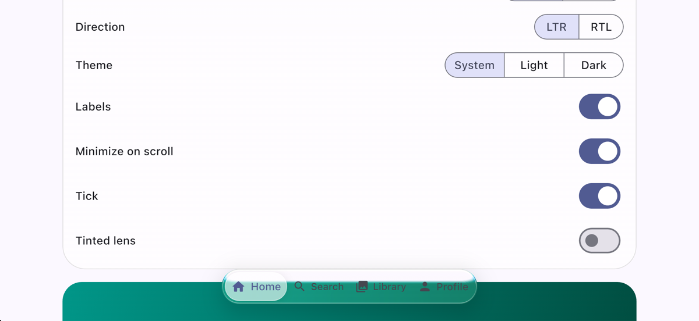
  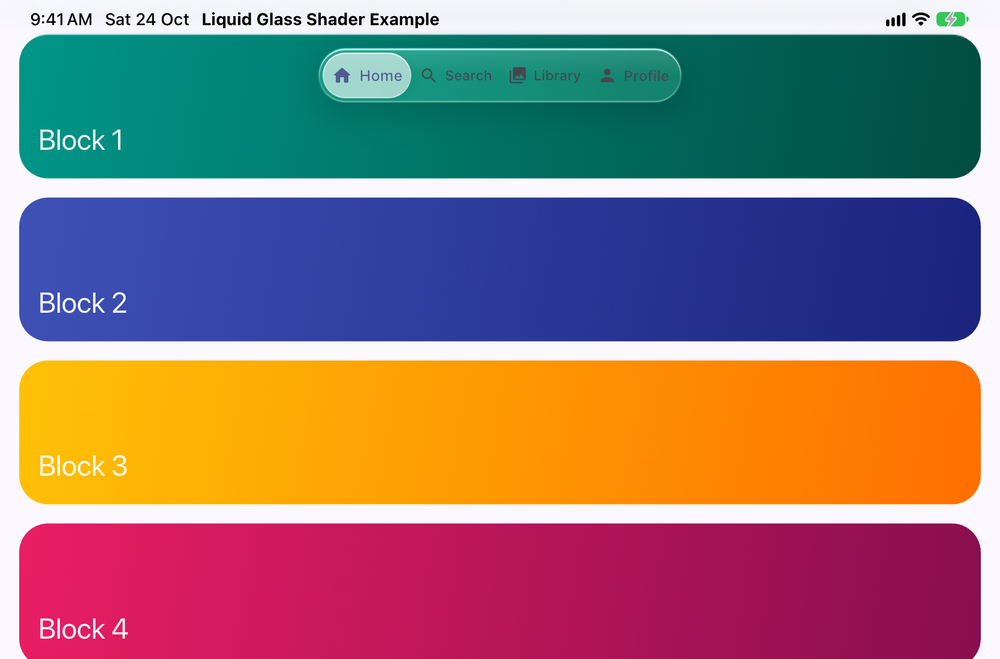
</p>

### A vertical bar at the side

`axis: Axis.vertical` stands the bar up as a column, as the iPhone Duo's cover screen does with its tab bar. The lens, the jelly, the rubber band and minimizing all follow the axis; a vertical bar runs from the top in either text direction, as Apple's does, and the arrow keys become up and down.

```dart
LiquidTabBar(
  axis: Axis.vertical,
  metrics: LiquidTabBarMetrics.vertical,
  alignment: Alignment.bottomCenter, // Apple's column sits at the bottom
  // ...
)
```

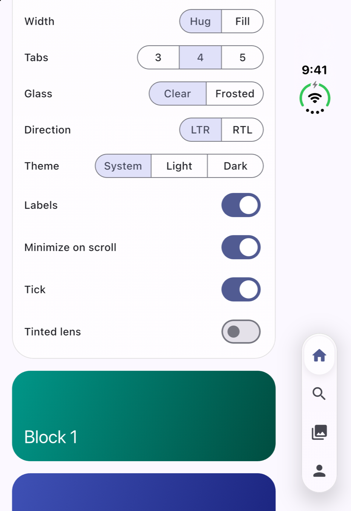

### Where to put it: adaptive placement

Where the bar sits on the screen, and when to give way to a sidebar or rail, is the app's choice: Apple and Material both decide it by size class, and Flutter has no size class for a package to read. The example's [`AdaptiveTabBarLayout`](example/lib/adaptive_tab_bar_layout.dart) is a short recipe to copy. It picks what iOS 27 does:

- a screen that keeps a column at one side for its bars (the iPhone Duo's cover screen, found by its one-sided side inset): `vertical`, standing in that column;
- a short screen, like an iPhone held sideways: `compactInline` along the bottom;
- a tablet or an unfolded phone, at least 600 both ways: `inline` along the top;
- anything else, like an iPhone held upright: `stacked` along the bottom.

```dart
final layout = AdaptiveTabBarLayout.of(context);
LiquidTabBar(
  axis: layout.axis,
  metrics: layout.metrics,
  minimized: layout.minimizes && scrolledDown, // only along the bottom
  // ...
)
```

### Minimize on scroll

`minimized: true` shrinks the bar into a pill that shows only the current tab (draw it with `minimizedBuilder`), as iOS does on iPhone while a page scrolls down; a tap on the pill, or Enter on it, calls `onExpand`. The bar keeps its size, so set it from the page's scroll direction without the page moving. A screen reader always gets the full bar. The pill sits where `minimizedAlignment` says: by default at the bottom of the start edge, or at the top of a vertical bar.

```dart
NotificationListener<UserScrollNotification>(
  onNotification: (n) {
    final down = n.direction == ScrollDirection.reverse;
    if (n.direction != ScrollDirection.idle && down != minimized) {
      setState(() => minimized = down);
    }
    return false;
  },
  child: page,
)
```

<p>
  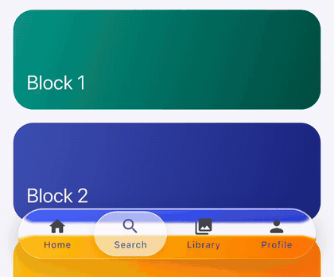
  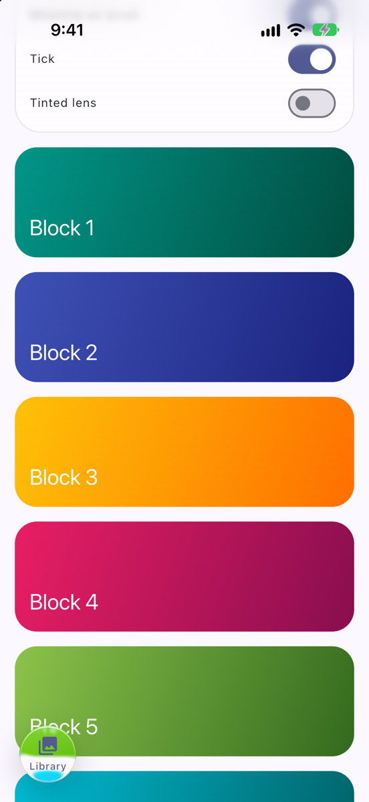
</p>

Apple supports minimizing on iPhone only; a bar along the top of an iPad stays put.

### Glass and lens

The bar's glass takes the same settings as `GlassSurface`: `style` (force clear or frosted), `look`, `rim`, `edge`, `strength` and `shadows`. `LiquidTabBarLens` sets the lens: its tint and its resting and lifted shadows (falling back to the `GlassScope` theme), the ring it draws under keyboard focus, and its size, magnification and optics once lifted.

```dart
LiquidTabBar(
  style: GlassStyle.frosted,
  shadows: const [BoxShadow(color: Color(0x29000000), blurRadius: 24, offset: Offset(0, 8))],
  lens: LiquidTabBarLens(
    tint: Theme.of(context).colorScheme.primary.withValues(alpha: 0.3),
    magnification: 1.25,
    liftedExtent: 1.25,
  ),
  // ...
)
```

<p>
  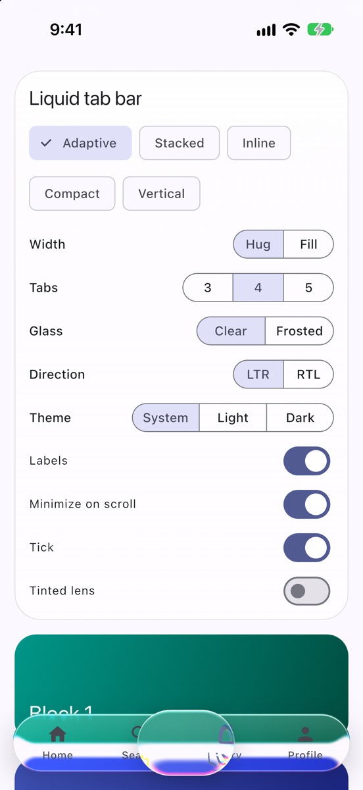
  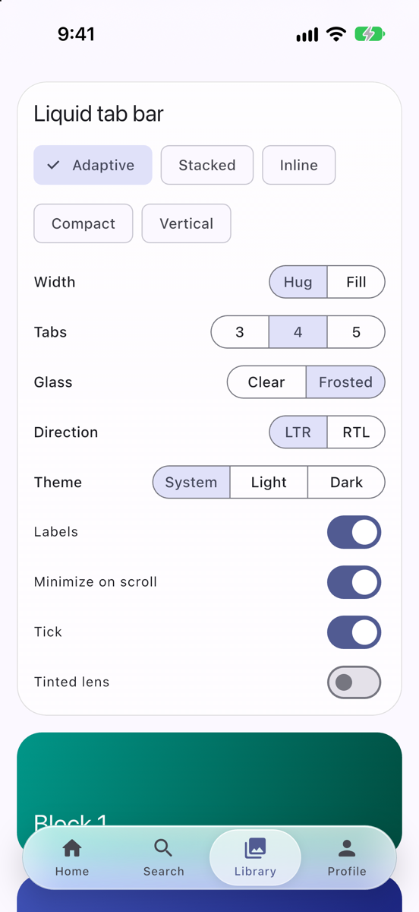
  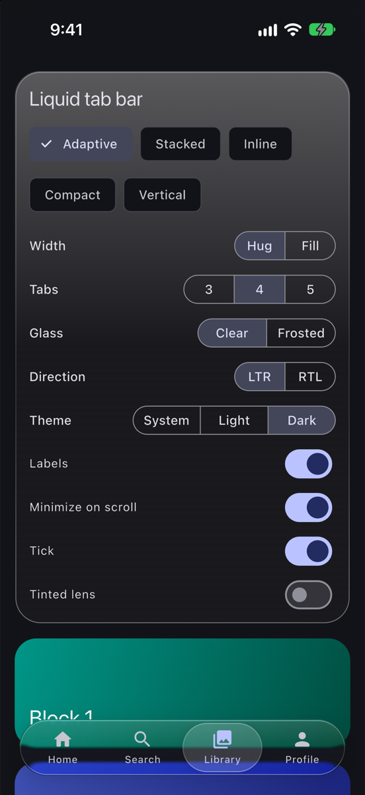
</p>

### Motion and the tick

`LiquidTabBarMotion` holds the springs and the feel: how the lens settles, lifts, drops and wobbles (the jelly), how fast it catches up with the finger, how far it stretches with speed, the rubber band past the ends, and how much the bar swells while pressed. The defaults match the iOS 26 tab bar, measured frame by frame.

```dart
LiquidTabBar(
  motion: LiquidTabBarMotion.standard.copyWith(
    maxStretch: 0.2,  // a firmer drop
    rubberBand: 0.1,
  ),
  onTick: (tab) => HapticFeedback.lightImpact(), // or null for none
  // ...
)
```

`onTick` hears each tab the lens moves onto, as a finger drags it or a key or screen reader selects; it plays the selection click by default (`LiquidTabBar.selectionClick`).

### Keyboard, screen readers and right to left

- With a keyboard (a tablet, a desktop, the web) the bar is one focus stop, as a tab list is: the arrows along the bar select the tab beside the current one on screen, Home and End jump to the ends, and a ring circles the lens while the focus came from the keyboard.
- Screen readers reach each tab as a button and tap it directly.
- Reduced motion keeps the lens flat and moves it from tab to tab at once, and minimizes at once.
- High contrast turns the glass into an opaque surface.
- In right-to-left text the tabs run from the right and the arrows follow the screen.

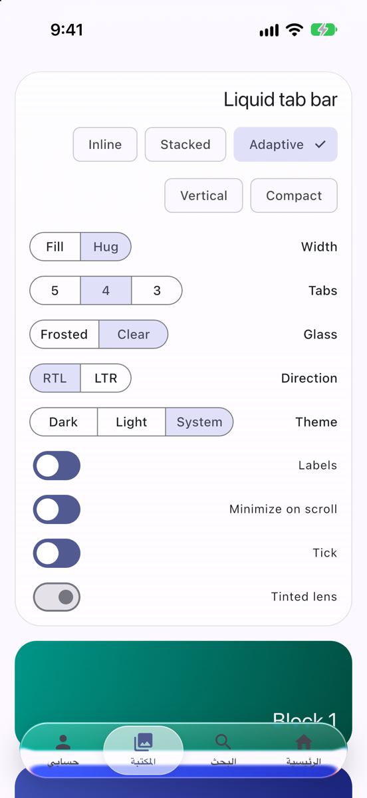

### Foldables

When a hinge, or a fold that is half open like a book, crosses the bar, the glass lays itself out on one side of it, so no tab sits on the crease: the side its alignment points to, or the larger side for a centred bar. Flat folds are left alone. The bar reads `MediaQuery.displayFeatures`, which Flutter fills on Android today; iOS will follow once Flutter reports the iPhone Duo's fold, with no change here.

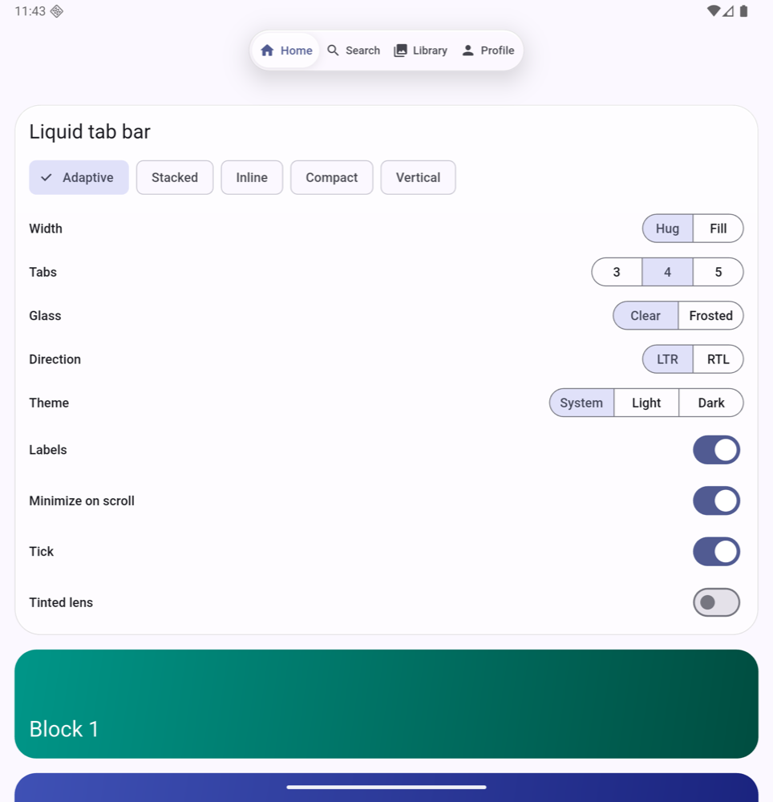

## Sharing the screen copy

Each piece of glass makes the engine copy the screen behind it, every frame, and that copy costs more than the shader's math. Glass that sets `shareBackdrop: true` (on `GlassSurface` or `LiquidTabBar`) reuses one copy per frame with other sharing glass under the same `GlassScope`.

A shared copy shows the screen as it was at the first sharing glass painted, so only share glass that is far apart, farther than its frost blurs (about three times the frost): a title bar at the top and a tab bar at the bottom, not a bar just above the tab bar, a sheet or glass over glass. Glass inside a page shares only while the page is current with nothing opening or closing over it, and half a second after it settles, so page transitions and closing sheets never show stale content. Shadows of glass always fall outside it, so a bar looks the same whether it shares or not.

## Theming

`GlassThemeData` holds the clear, regular and frosted looks, the rim, edge hairline, the opaque fill used at the solid tier, and the lens tint and shadows. `GlassThemeData.light()` and `.dark()` carry the looks measured on iOS 27; pass your own to match your palette. A `GlassLook` sets `frost`, `diffusion`, `dim`, `tint`, the rim `band`, `bend`, `dispersion`, the `specular` highlight, `sheen` and `saturation`; `GlassLook.lerp` blends two, and `GlassThemeData.lookAt` gives the look at a `tinting`. The rim is lit where the glass faces up or down and its hairline is darkest at the sides, as iOS 27 draws them. A single tab bar can override the lens colours with `LiquidTabBarLens`.

## Performance

Glass draws at one of three tiers (`GlassQuality`): refraction, blur, or solid. While glass is on screen, `GlassScope` watches each frame's raster time and how late it lands (on iPhone the GPU's work never shows in raster time, so a GPU that cannot keep up shows only as frames landing late). Gaps after the app was idle are not judged, and gaps are measured against the window's usual gap, so a display that runs slower than it reports (Low Power Mode) does not look slow. After two windows of one second of drawing in a row in which more than 10% of the frames were late, or a single window in which more than half were, it steps down one tier for the rest of the session. Windows are time, not frame counts, so a weak phone that draws only a few frames a second steps down as fast as any other: at the 189 ms a frame the Android emulator took with software rendering, every frame is late, and glass steps down a tier in each second of drawing. Only frames in which glass drew a backdrop count, so a page covered by another one, or glass under an `Offstage`, never loses its glass for jank elsewhere; and each tier is judged only by frames drawn at it, though the engine reports frame timings up to a second late. Once glass is solid, or with the guard off, the scope stops watching frames. Tune or switch this off with `GlassGuard`.

The scope stores nothing. To keep a slow phone from stuttering again on every launch, save the tier it reports and start from it next time:

```dart
GlassScope(
  initialCap: savedCap, // read from your storage once, at startup
  onCapChanged: (cap) => save(cap),
  child: child,
)
```

Consider letting the saved tier expire (after a week, say), so a phone that had one slow day, or got an update, gets its glass back.

The tab bar builds its glass once per change of state, never per frame: while the lens slides, lifts or stretches, only the lens rebuilds and repaints, in layers of its own, and the swell and the shrink into the pill run as transitions. At rest the tabs take no clip, and the lens fades by its colours rather than through opacity layers, so lifting and dropping it costs no offscreen pass. With 0.3.0, on an iPhone 17 Pro Max at 120 Hz and the example's frame-time test (`example/integration_test/tab_bar_perf_test.dart`, in profile mode), a page scrolling under the bar, a finger scrubbing it and the lens sliding between tabs averaged 0.35 to 0.49 ms of UI build time and 1.2 to 1.5 ms of raster time a frame, and no frame missed its budget.

A fast GPU hides what weaker ones pay for. Drawn by Impeller's software renderer (SwiftShader), which pays for every pixel the way a weak GPU does, a 1080 by 2340 frame of a colourful page took 105 ms; the stacked tab bar over it added:

| The bar | 0.3.0 | 0.3.1 |
| --- | --- | --- |
| Refraction, clear | 292 ms | 66 ms |
| Refraction, the lens held | 361 ms | 102 ms |
| Refraction, frosted | 99 ms | 100 ms |
| Blur, clear | 80 ms | 78 ms |
| Solid | 13 ms | 12 ms |

The clear look's frost had cost more than everything else in the glass together. On Impeller, clear refraction now costs about what the blur tier does, so a phone that cannot keep up with one usually cannot with the other; the guard moves on from a tier that did not help within a second when most frames stay late.

The same scenes for 0.4.0, on a faster machine that drew the page alone in 16 ms. The example's `test/glass_bench_test.dart` measures them; 0.3.1 and 0.4.0 ran in turn, nine times each, and each figure is the fastest:

| The bar | 0.3.1 | 0.4.0 |
| --- | --- | --- |
| Refraction, clear | 15.6 ms | 15.6 ms |
| Refraction, clear, the lens held | 27.9 ms | 28.6 ms |
| Refraction, regular | | 17.1 ms |
| Refraction, regular, the lens held | | 31.6 ms |
| Refraction, frosted | 28.9 ms | 17.6 ms |
| Refraction, frosted, the lens held | 41.0 ms | 30.0 ms |
| Blur, clear | 19.1 ms | 18.2 ms |
| Blur, regular | | 15.4 ms |
| Blur, frosted | 17.2 ms | 17.6 ms |
| Solid | 1.8 ms | 1.2 ms |

On that renderer a backdrop layer costs about 12 ms whatever its filter does (one that changes nothing took 12.3 ms), and the shader's own work is the small rest. Frosted glass had paid for a second pass, the engine's blur in front of the shader, over the whole screen; it and the regular look now scatter the page inside the shader, in the one pass. The lifted lens is a second backdrop layer, because it refracts the bar's own tabs.

Avoid composing your own filters in front of the glass: a blur in front of a shader filter runs over the whole screen at full resolution.

## Limitations

- Refraction uses one corner radius per surface: the smallest of its corners. The clip still rounds the rest, so a sheet with square bottom corners stays glass all the way down.
- Glass is for chrome over content. Refraction behind body text makes it harder to read.
- The light frost taken in the shader comes within a pixel of the engine's Gaussian blur at an edge, but is sixteen reads, not a true Gaussian. Above 6 physical pixels of blur it would show its taps, so heavier frost is the engine's blur.
- The diffusion is thirty-two reads, turned at each pixel, not a true blur. Over the harshest page, black and white stripes, it leaves a grain of about 1.5% from one physical pixel to the next, under 0.5% once averaged over a logical pixel at 3x; on a low-density screen it may show over such a page.
- The looks match iOS 27 on flat colour to within a few levels, in light and dark and at each stop of the slider (measured on the iOS 27.0 simulator). Over black and white stripes, light regular glass comes out about 5% darker than Apple's, which averages in brighter. iOS also makes larger glass more opaque and dims it more in dark mode; here a look is the same at every size.
- iOS 27 shows no colour split at the rim, so the looks set `dispersion` to 0; the lifted lens of the tab bar keeps its own.
- Inside the lifted lens, iOS tints everything with the selection colour; `LiquidTabBar` only draws the tab under the lens as current.
- Tabs share the bar's length equally; iOS sizes each tab to its label.
- Folds reach the bar only where Flutter reports them: on Android today. On the Android emulator's Pixel 10 Pro Fold (API 36 image), apps received no fold even half open, so the fold above is shown flat; the stepping aside is covered by tests.

## Migrating from 0.3

- Glass is regular unless told otherwise: `GlassScope.style` defaults to `GlassStyle.regular`, and so does glass without a scope. Pass `style: GlassStyle.clear` for the glass of 0.3.
- `GlassThemeData` needs a `regular` look. The looks of `GlassThemeData.light()` and `.dark()` are retuned to iOS 27: a stronger bend, no colour split, no sheen, the rim lit along the top and the bottom, a darker lens with no rim or shadow at rest. Glass that should keep the 0.3 look can pass its old values as a `GlassLook`.
- The frosted look no longer blurs: it scatters, with `diffusion`. A look of your own with a heavy `frost` still blurs.

## Migrating from 0.2

- `height` and `inset` move into `metrics: LiquidTabBarMetrics(...)`, and `thickness` is the whole bar, glass included: `height: 64` with the default inset of 4 is `thickness: 72`.
- The bar now hugs its tabs like iOS. Pass `tabExtent: double.infinity` to fill the width as before.
- `style: LiquidTabBarStyle(...)` splits into `motion: LiquidTabBarMotion(...)` (the springs, `catchUp`, `pressedScale`, `stretchPerSpeed`, `maxStretch`, `speedSmoothing`, `rubberBand`) and `lens: LiquidTabBarLens(...)`, where `liftedWidth` and `liftedHeight` become `liftedExtent` and `liftedThickness`, and `lensBand`, `lensBend`, `lensDispersion` and `lensSpecular` become `band`, `bend`, `dispersion` and `specular`. `style` on the bar now forces clear or frosted glass, as on `GlassSurface`.
- `minimizedSize` moves to `LiquidTabBarMetrics`, and defaults to the bar's thickness.
- `haptics: false` becomes `onTick: null`.

## License

MIT. See [LICENSE](LICENSE).
